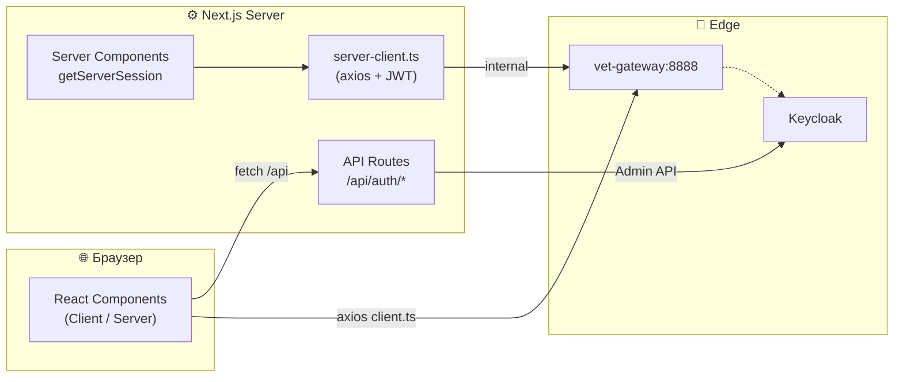

# 🐾 Veterinary Platform — Frontend


> Веб-клиент «Единой цифровой платформы для ветеринарных клиник»: личный кабинет владельца питомца, рабочее место врача и панель администратора, реализованные на Next.js с поддержкой серверного рендеринга и ролевого доступа.

---

## 📋 О проекте

**Vet Frontend** — одностраничное приложение (SPA) на базе Next.js 14 с использованием App Router. Обеспечивает взаимодействие с пользователем через REST API шлюза (`vet-gateway`) и покрывает все ключевые сценарии платформы: аутентификацию, ведение питомцев, управление клиниками, врачами и медикаментами, запись на приём и мониторинг здоровья животных по данным умных ошейников.

Приложение полностью скрывает Keycloak от конечного пользователя: вход и регистрация выполняются через кастомные формы, а обмен с OAuth2-сервером происходит на стороне Next.js API-роутов.

### Ключевые особенности

- **Ролевая модель** — единый интерфейс, адаптирующийся под роль пользователя (`OWNER`, `DOCTOR`, `ADMIN`): состав меню, доступные действия и наполнение страниц меняются динамически.
- **Серверные компоненты** — загрузка данных на сервере через `getServerSession`, что ускоряет первый рендер и снижает объём передаваемого JavaScript.
- **Автоматическое обновление токена** — перехватчики axios обновляют access-token через refresh-token при получении 401, без разлогина пользователя.
- **Единый серверный API-клиент** — обращения к бэкенду из серверных компонентов идут по внутренней сети Docker через `vet-gateway:8888`, из браузера — через публичный адрес.
- **Строгая типизация форм** — валидация на Zod, работа с формами через React Hook Form, включая сложные динамические массивы (вакцинации, аллергии, хронические болезни).
- **IoT-визуализация** — интерактивная карта (Leaflet) с геозоной и графики показателей (Recharts) с автообновлением.
- **Многоканальность** — часть функциональности дублируется в VK-боте, поэтому веб-клиент поддерживает механизм привязки VK-аккаунта.

---

## 🏗 Архитектура



---

## ✨ Модули приложения

| Модуль | Доступ | Возможности |
|---|---|---|
| 🔐 **Аутентификация** | Все | Вход и регистрация через кастомные формы, скрытый Keycloak, роли в сессии, refresh токена |
| 🏠 **Дашборд** | Все | Сводка по питомцам, ближайшие приёмы, аномалии здоровья, статус склада (для админа) |
| 🐾 **Питомцы** | Все | CRUD питомцев, динамическая медкарта (вакцинации, аллергии, хронические болезни), настройка умного ошейника, QR-код и публичная страница по QR |
| 👨‍⚕️ **Врачи** | Все | Список врачей с фильтром по клинике, карточка врача, отзывы с рейтингом, форма создания/редактирования для админа |
| 🏥 **Клиники** | Админ | CRUD филиалов сети с названием, адресом и телефоном |
| 💊 **Лекарства** | Админ | Табличный склад с фильтром по клинике, индикатор «Нужен заказ», CRUD медикаментов |
| 📅 **Записи на приём** | Все (по ролям) | Просмотр предстоящих и истории, создание записи с выбором клиники/врача/слота, отмена, завершение приёма врачом с назначением лекарств |
| ❤️ **Здоровье** | Все | Выбор питомца, текущие показатели с картой и статусом ошейника, график истории, рекомендации и запрос анализа |
| 🔗 **Привязка VK** | Все | Страница `/link-vk?token=...` для связывания аккаунта с VK-ботом через одноразовую ссылку |

---

## 🛠 Технологический стек

**Фреймворк и язык**
- Next.js 14 (App Router, Server Components)
- React 18, TypeScript 5

**Аутентификация**
- NextAuth 4 (Credentials Provider)
- Keycloak (OAuth2 / JWT)

**Управление состоянием**
- TanStack React Query 5 (серверный стейт, кэш, инвалидация)
- React Hook Form + Zod (формы и валидация)

**UI и стили**
- Tailwind CSS 3
- shadcn/ui (Radix UI primitives)
- Lucide React (иконки)
- Sonner (тостовые уведомления)

**Визуализация данных**
- Recharts (графики показателей здоровья)
- Leaflet + React-Leaflet (карта и геозона)
- date-fns + date-fns-tz (работа с датами и часовыми поясами)

**Инфраструктура**
- Axios (HTTP-клиент с интерсепторами)
- Docker (production-образ на базе `node:20-alpine`, standalone output)

---

## 📁 Структура проекта

```
frontend/
├── app/
│   ├── (auth)/
│   │   ├── login/page.tsx          # Форма входа
│   │   └── register/page.tsx       # Форма регистрации
│   ├── (dashboard)/
│   │   ├── layout.tsx              # Макет с Header и Sidebar
│   │   ├── page.tsx                # Дашборд
│   │   ├── pets/                   # Список, создание, детали, редактирование
│   │   ├── appointments/           # Список, создание записи
│   │   ├── doctors/                # Список, детали, создание, редактирование
│   │   ├── clinics/                # CRUD клиник (админ)
│   │   ├── medications/            # Склад лекарств (админ)
│   │   ├── health/                 # Мониторинг здоровья
│   │   └── profile/                # Профиль владельца
│   ├── link-vk/page.tsx            # Привязка VK-аккаунта
│   ├── qr/[code]/page.tsx          # Публичная карточка питомца по QR
│   ├── api/auth/[...nextauth]/     # Обработчик NextAuth
│   ├── api/auth/login/             # Прокси к Keycloak (password grant)
│   ├── api/auth/register/          # Регистрация (Admin API + Profile Service)
│   ├── layout.tsx                  # Корневой layout
│   └── globals.css
├── components/
│   ├── layout/                     # Header, Sidebar, SidebarContent
│   ├── providers/                  # SessionProvider, QueryProvider
│   ├── pets/                       # PetCard, PetForm, MedicalRecordView, QRCodeDisplay
│   ├── doctors/                    # DoctorCard, AddDoctorForm, ReviewForm, ReviewsSection
│   ├── clinics/                    # ClinicCard, ClinicForm
│   ├── medications/                # MedicationTable, MedicationForm, MedicationFilters
│   ├── appointments/               # AppointmentList, AppointmentForm, DoctorSelector
│   ├── health/                     # CollarStatus, VitalsChart, RecommendationsPanel
│   ├── dashboard/                  # Виджеты главной страницы
│   └── ui/                         # shadcn/ui компоненты
├── hooks/                          # usePets, useDoctors, useAppointments, useMedications, useHealthData, useClinics, useReviews, useUserSearch
├── lib/
│   ├── api/                        # client.ts, server-client.ts, pets.ts, doctors.ts, ...
│   ├── auth/                       # options.ts, keycloak-admin.ts, refresh-token.ts
│   ├── validations/                # Zod-схемы
│   └── utils.ts
├── types/                          # Типы DTO (pet, doctor, appointment, medication, health, clinic, next-auth)
├── middleware.ts                   # Защита маршрутов
├── Dockerfile                      # Production-сборка
├── next.config.js                  # standalone output
├── tailwind.config.ts
├── package.json
└── README.md
```

---

## 🚀 Быстрый старт

### Требования

- Node.js 20+
- npm 10+ (или pnpm/yarn)

### Локальный запуск

```bash
# Установка зависимостей
npm install

# Создать .env.local на основе шаблона
cp .env.example .env.local
# (отредактировать переменные при необходимости)

# Запуск dev-сервера
npm run dev
```

Приложение будет доступно по адресу [http://localhost:3000](http://localhost:3000).

### Production-сборка

```bash
npm run build
npm run start
```

### Запуск в Docker

```bash
# Собрать образ
docker build -t vet-frontend .

# Запустить контейнер
docker run -p 3000:3000 --env-file .env.local vet-frontend
```

Или через корневой `compose.yaml` проекта — сервис `frontend`.

---

## ⚙️ Конфигурация

Все параметры задаются через переменные окружения в `.env.local` (локально) или в `compose.yaml` (в контейнере).

```env
# --- NextAuth ---
NEXTAUTH_URL=http://localhost:3000
NEXTAUTH_SECRET=<32-символьная случайная строка>

# --- Keycloak ---
NEXT_PUBLIC_KEYCLOAK_BASE_URL=http://localhost:8080
NEXT_PUBLIC_KEYCLOAK_ISSUER=http://localhost:8080/realms/clinic-realm
NEXT_PUBLIC_KEYCLOAK_CLIENT_ID=vet-frontend
KEYCLOAK_BASE_URL=http://keycloak:8080
KEYCLOAK_ISSUER=http://keycloak:8080/realms/clinic-realm
KEYCLOAK_REALM=clinic-realm
KEYCLOAK_CLIENT_ID=vet-frontend
KEYCLOAK_CLIENT_SECRET=<секрет клиента vet-frontend>

# --- Административный клиент (для регистрации) ---
KEYCLOAK_ADMIN_CLIENT_ID=profile-service
KEYCLOAK_ADMIN_CLIENT_SECRET=<секрет клиента>

# --- API ---
NEXT_PUBLIC_API_URL=/api            # Публичный префикс (проксируется через edge)
API_URL_INTERNAL=http://vet-gateway:8888  # Внутренний адрес шлюза для серверных запросов

# --- Frontend ---
FRONTEND_URL=http://localhost:3000
```

> **Важно:** в продакшене `KEYCLOAK_BASE_URL` и `API_URL_INTERNAL` указывают на внутренние имена Docker-сервисов (`keycloak`, `vet-gateway`), а `NEXT_PUBLIC_*` — на публичные адреса, доступные браузеру.

---

## 🔐 Аутентификация

Процесс полностью скрывает Keycloak от пользователя:

1. Пользователь заполняет кастомную форму входа или регистрации (`/login`, `/register`).
2. **Вход:** запрос проксируется через `POST /api/auth/login` → password grant к Keycloak → токены возвращаются в NextAuth.
3. **Регистрация:** `POST /api/auth/register` создаёт пользователя через Keycloak Admin API, получает user-token, создаёт профиль владельца в Profile Service. При ошибке пользователь удаляется из Keycloak (rollback).
4. Роли (`ADMIN`, `DOCTOR`) извлекаются из `realm_access` JWT и сохраняются в сессии (`isAdmin`, `isDoctor`).
5. `middleware.ts` защищает все маршруты, кроме `/login`, `/register`, `/link-vk` и публичных QR-страниц.
6. Клиентский `apiClient` автоматически обновляет токен при 401 через refresh-token.

---

## 📡 Работа с API

Все обращения к бэкенду идут через `vet-gateway`. В проекте два HTTP-клиента:

- **`lib/api/client.ts`** — для клиентских компонентов. Токен берётся из сессии через `getSession`, при 401 выполняется автоматический refresh.
- **`lib/api/server-client.ts`** — для серверных компонентов и API-роутов. Использует `getServerSession` и `API_URL_INTERNAL`.

Каждый модуль имеет свой файл API-функций (`pets.ts`, `doctors.ts`, `appointments.ts`, `medications.ts`, `health.ts`, `clinics.ts`, `reviews.ts`) с разделением на `server` и `client` методы. Серверные страницы вызывают `api.server.*`, клиентские формы — `api.client.*` через хуки React Query.

---

## 🎨 UI/UX

- **Адаптивность** — единый макет подстраивается под мобильные, планшеты и десктопы. Sidebar превращается в выезжающее меню.
- **Ролевой интерфейс** — пункты меню и кнопки действий показываются только при наличии соответствующих прав.
- **Состояния загрузки** — скелетоны и спиннеры, тостовые уведомления об успехе и ошибках.
- **Валидация** — мгновенная обратная связь по полям формы, русифицированные сообщения.

---

## 🧪 Скрипты

```bash
npm run dev      # Запуск dev-сервера
npm run build    # Production-сборка
npm run start    # Запуск собранного приложения
npm run lint     # ESLint
```

---

## 🔗 Связанные репозитории

| Компонент | Репозиторий |
|---|---|
| API Gateway | [vet-gateway](https://github.com/Cookie-Boy/vet-gateway) |
| Profile Service | [profile-service](https://github.com/Cookie-Boy/profile-service) |
| Management Service | [management-service](https://github.com/Cookie-Boy/management-service) |
| Appointment Service | [appointment-service](https://github.com/Cookie-Boy/appointment-service) |
| Pet Wearable Service | [petwearable-service](https://github.com/Cookie-Boy/petwearable-service) |
| Pet Health Analyzer | [pet-health-analyzer-service](https://github.com/Cookie-Boy/pet-health-analyzer-service) |
| VK Bot Service | [bot-service](https://github.com/Cookie-Boy/bot-service) |
| Корневой проект | [veterinary-platform](https://github.com/Cookie-Boy/veterinary-platform) |

---
